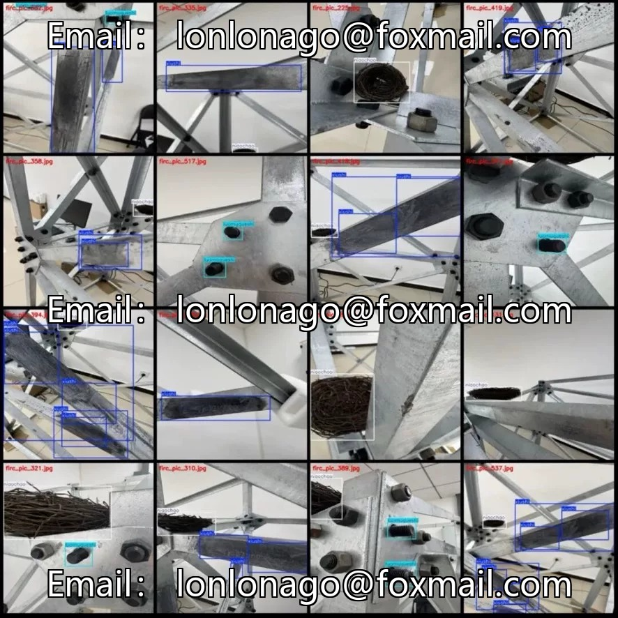
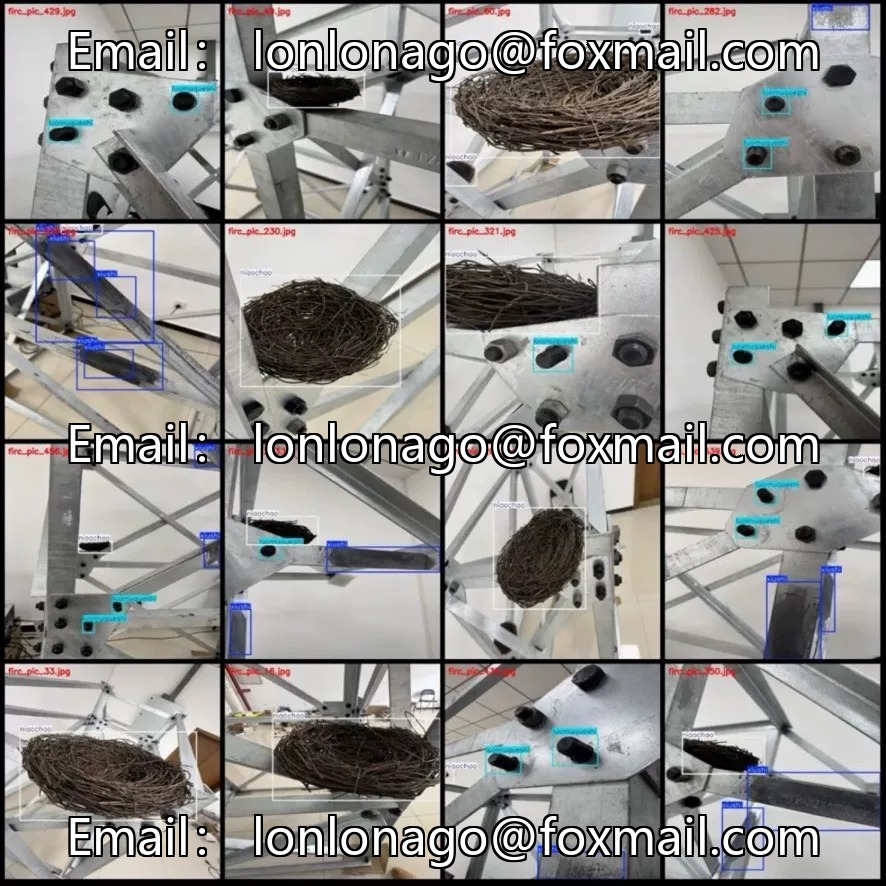
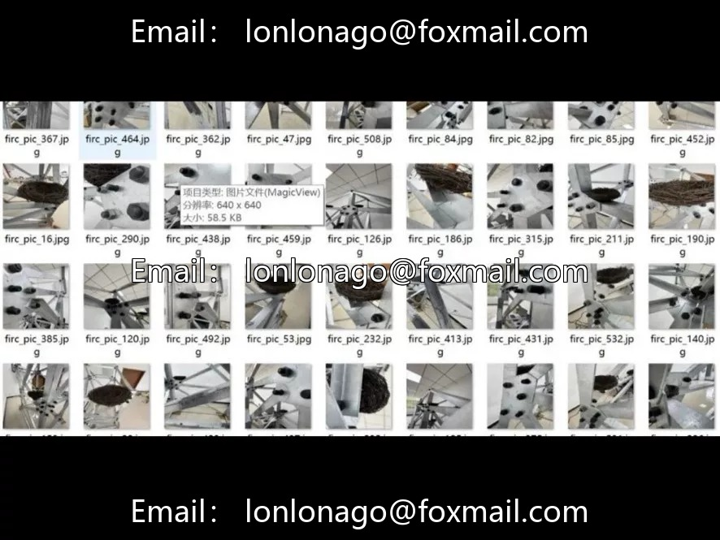

# Power Scene Defect Detection Dataset, VOC+YOLO dual format, 540 images of 64x64

## Body

Power Scene Defect Detection Dataset, VOC+YOLO dual format, 540 images of 640x640 resolution, 3 categories of typical power facility defects: rust (xiushi), bird's nest (niaochao), missing nuts (luomuqueshi), with a total of 1510 labeled bounding boxes. Some images have multiple labels, and the distribution of samples is uneven, with the most bird's nest and the least missing nuts. The dataset has not been divided into training/validation/test sets, suitable for scenarios such as power inspection and drone defect detection, can be directly used for model training.

Virtual materials, once sold, are non-refundable.
Interested friends, click "I want" to proceed.

## Images

## Payment

Here is a pay link on Stripe ( https://buy.stripe.com/3cs8yP7sY87d0vu9AB ). Please contact me lonlonago@foxmail.com after funding $89, and I will send you a complete data files , thank you!

